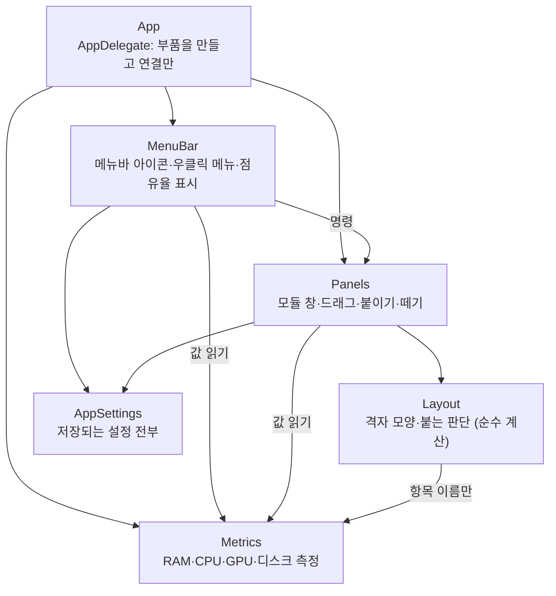

# potatus hub 구조

기능을 추가하거나 고치기 전에 이 문서를 먼저 읽는다. 구조가 바뀌면(파일을 만들거나 옮기거나, 부품끼리 쓰는 방향이 바뀌면) 같은 커밋에서 이 문서도 고친다.

맥 앱 기준이다. Windows 대응은 맨 아래 표에 있다.

## 구조도



화살표는 "쓰는 방향"이다. 반대 방향으로는 쓰지 않는다.

- `Metrics`와 `Layout`은 화면을 모른다. `Panels`나 `MenuBar`를 import하거나 부르지 않는다.
- `Panels`는 `MenuBar`를 모른다. 메뉴는 `Panels`의 공개 함수만 부른다.
- `UserDefaults`는 `AppSettings`에서만 읽고 쓴다.

## 폴더와 파일

모두 `Sources/PotatusHub/` 아래다.

| 폴더 | 파일 | 맡은 일 |
|---|---|---|
| `App/` | `PotatusHubApp.swift` | 시작점 |
| | `AppDelegate.swift` | 부품 생성과 연결, 측정을 돌릴지 멈출지 결정, 종료 때 저장 |
| | `AppSettings.swift` | 저장 키 전부: 모듈 켜짐, 메뉴바 표시 항목, 언어, 모듈 위치(`SavedGroup` 저장 모양도 여기) |
| | `Localization.swift` | `L.t(ko:en:ja:zh:)` 4개 언어 문구 |
| | `AboutPanel.swift` | 정보 창 |
| | `LaunchAtLogin.swift` | 로그인 시 자동 실행 |
| `Metrics/` | `MetricKind.swift` | 항목 정의: 이름·아이콘·색 |
| | `MetricSampler.swift` | 재는 부품의 규격 |
| | `MemorySampler.swift`, `CPUSampler.swift`, `GPUSampler.swift`, `DiskSampler.swift` | 항목별 재는 부품 |
| | `SystemMonitor.swift` | 1초 타이머, 항목별 주기, 값 보관(`MetricValue`) |
| `Layout/` | `ModuleLayout.swift` | 격자 모양(가로·세로·ㄴ자), 합치기·빼기, `ModuleAxis`, `MergeDirection` |
| | `LayoutMetrics.swift` | 칸 크기 같은 치수 |
| | `SnapEngine.swift` | 놓은 모듈이 어디에 붙을지 판단 |
| `Panels/` | `ModulePanel.swift` | 창 하나와 마우스 처리(드래그, 길게 누르기, 더블클릭) |
| | `ModuleView.swift` | 모듈 그리기(SwiftUI) |
| | `PanelCoordinator.swift` | 창 목록, 항목 켜기·끄기, 보이기·숨기기, 정렬·결합·분리, 위치 저장·복원 |
| | `PanelCoordinator+Docking.swift` | 드래그 뒤 붙이기, 길게 눌러 떼기 |
| | `PanelCoordinator+Orientation.swift` | 가로↔세로 전환, 분리 애니메이션 |
| | `TransitionGate.swift` | "지금 자동으로 움직이는 중" 표시 |
| `MenuBar/` | `StatusItemController.swift` | 메뉴바 아이콘, 클릭 처리, `[아이콘] 62%` 표시 |
| | `AppMenu.swift` | 우클릭 메뉴 만들기와 메뉴 동작 |

시험은 `Tests/PotatusHubTests/`에 있다: `ModuleLayoutTests`, `SnapEngineTests`, `ShadowRenderingTests`, `MetricSamplerTests`, `AppSettingsTests`, `TransitionGateTests`.

## 무엇을 고칠 때 어디를 여나

| 하려는 일 | 여는 파일 |
|---|---|
| 측정 항목 추가 | `MetricKind.swift`에 case, `Metrics/`에 재는 파일 하나, `SystemMonitor.swift`의 재는 부품 목록 한 줄 |
| 재는 방법·주기 바꾸기 | 그 항목의 `*Sampler.swift` |
| 모듈 모양·색·글자 | `ModuleView.swift`, `MetricKind.swift` |
| 붙는 거리·붙는 방향 판단 | `SnapEngine.swift` |
| 합친 모양 규칙(ㄴ자, 빼면 어떻게 되나) | `ModuleLayout.swift` |
| 붙을 때·떼어낼 때 움직임 | `PanelCoordinator+Docking.swift` |
| 가로↔세로 전환 움직임 | `PanelCoordinator+Orientation.swift` |
| 드래그·길게 누르기 감지 | `ModulePanel.swift` |
| 메뉴 항목 추가·문구 | `AppMenu.swift` |
| 메뉴바 표시 | `StatusItemController.swift` |
| 새 설정 저장 | `AppSettings.swift` |

## 지켜야 할 약속

1. **좌표는 "보이는 카드" 기준으로 계산한다.** 창은 그림자 때문에 카드보다 사방 `ModulePanel.shadowMargin`만큼 크다. `Layout/`은 보이는 카드 좌표만 다루고, 창 좌표로 바꾸는 일은 `Panels/`가 `visibleFrame`·`setVisibleFrame`·`windowOrigin(forVisibleOrigin:)`으로 한다.
2. **코드가 창을 움직일 때는 `TransitionGate`를 잡는다.** 잡고 있는 동안에는 `windowDidMove`가 붙이기를 다시 시작하지 않는다. `begin()`과 `end()`만 쓴다. 2초 넘게 안 풀리면 스스로 풀린다(애니메이션 완료가 안 불려도 붙이기가 먹통이 되지 않게).
3. **값은 정수 %로 반올림해 바뀔 때만 알린다.** 각 칸은 자기 항목의 `MetricValue`만 본다. 한 항목이 바뀌어도 다른 칸은 다시 그리지 않는다.
4. **측정은 필요할 때만 돈다.** 모듈이 화면에 보이거나, 메뉴바 표시 항목이 하나라도 켜져 있을 때다. 화면이 꺼지면 멈춘다.
5. **붙어 있는 칸은 변을 맞대야 한다.** 모서리만 닿은 칸은 한 묶음이 아니다(`ModuleLayout.isEdgeConnected`).
6. **세로 3단만 칸 높이가 69pt다**(potatoken hub의 큰 패널 높이 207pt에 맞춤). 그 밖에는 78pt다.
7. **저장된 위치는 창 좌표다.** `AppSettings`에 그림자 여백 값도 같이 저장하고, 복원할 때 그 값으로 보이는 카드 위치를 되찾는다.

## 빌드와 시험

```bash
swift build
swift test
./Scripts/build-app.sh    # .build/potatus hub.app 을 만든다
```

Claude 세션에서는 샌드박스 안에서 `swift build`가 막힌다. 샌드박스 밖에서 실행한다.

## Windows 대응

Windows 앱(`windows/PotatusHub/`)은 아직 이 구조로 나누지 않았다. 디스크 모듈과 트레이 표시도 아직 없다.

| 맥 | Windows |
|---|---|
| `Metrics/MetricKind.swift` | `MetricKind.cs` |
| `Metrics/SystemMonitor.swift`와 `*Sampler.swift` | `SystemMonitor.cs` |
| `Layout/ModuleLayout.swift` | `ModuleLayout.cs` |
| `Layout/SnapEngine.swift`, `Panels/PanelCoordinator*.swift`, `MenuBar/*`, `App/AppDelegate.swift` | `App.xaml.cs` |
| `Panels/ModulePanel.swift`, `Panels/ModuleView.swift` | `ModulePanel.xaml`, `ModulePanel.xaml.cs` |
| `App/AppSettings.swift` | `AppSettings.cs` |
| `App/Localization.swift` | `Localization.cs` |
| `App/LaunchAtLogin.swift` | `LaunchAtLogin.cs` |
